# T09 答案册

内容版本：0.2.0-t09.1。30 题与 6 个 END 独立计数。所有题目 revision=1。

可以任选类别、跳过已掌握内容，或直接参加对弈。5×5 均是真实小棋盘；数值参数为教学选择。开放题以依据、回应和倾听反馈，不设唯一最佳手。

人类专业审题与实体课堂试用尚未进行。内容已按明确范围完成模型推导、结构检查与原引擎核查。

术语沿用前置工程 docs/TERMINOLOGY.md。气（liberty）、打吃（atari）、提子（capture）、连接（connection）、真眼（true eye）、假眼（false eye）、贴目（komi）、面积计分（area scoring）在首次相关题出现。

来源见 [SOURCES](../t09/SOURCES.md)，检查见 [validation-report](../validation-report.md)。

## 目录

- LIB-001：中央单子的四周
- LIB-002：真正的角上只有两向
- LIB-003：连成一块一起数
- LIB-004：折形的共享气
- LIB-005：整块与敌子共同限制
- CAP-001：补最后一口气
- CAP-002：沿边提掉整块
- CAP-003：边线方向少一条
- CAP-004：一手同时提两块
- CAP-005：先提子再检查自杀
- CON-001：一间空点连接
- CON-002：斜邻有两条接法
- CON-003：打吃时向外延伸
- CON-004：边上搭桥
- CON-005：逃跑同时接到同伴
- LIFE-001：两个独立真眼
- LIFE-002：看似眼的点可以被吃进
- LIFE-003：先手把三点空间分开
- LIFE-004：四点空间的防守要点
- LIFE-005：两点相连仍是一个眼区
- AREA-001：清楚围空：子与空都计入
- AREA-002：中立空区：不分给任何一方
- AREA-003：确认死子后再计算
- AREA-004：贴目变化：同一面积不同结果
- AREA-005：提子更多也不额外加分
- DISC-001：连接还是向空处发展
- DISC-002：救一颗子与改变方向
- DISC-003：十三路上的两种距离
- DISC-004：提子还是先连接
- DISC-005：停手前先核对争议
- END-001：清楚围空：子与空都计入
- END-002：中立空区：不分给任何一方
- END-003：确认死子后再计算
- END-004：贴目变化：同一面积不同结果
- END-005：提子更多也不额外加分
- END-006：反例：未完与争议不能报终局分

## LIB-001  r1　中央单子的四周

完整 9×9 棋盘　黑方轮次　新教学起点

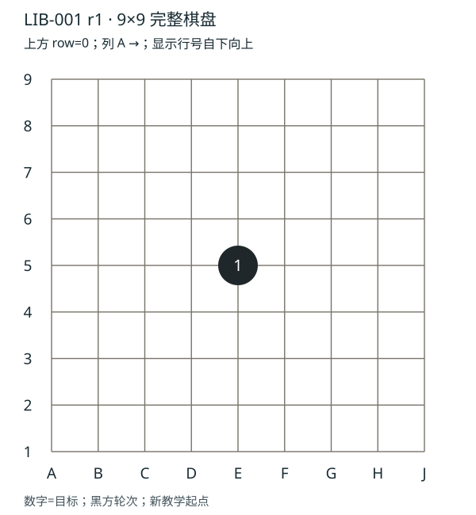

数出标记黑棋整块的全部气（liberties）。只回答，不落子。

完整坐标：黑：E5；白：无

条件：见完整棋盘；仅按题干即时或有限目标作答。

成功标准：数字准确；不判断活死。

### 答案与解释

气为 E6 D5 F5 E4，共 4 口。斜角有空位，但不沿棋盘线与 E5 相邻。

### 三层提示

1. 沿线找上下左右相邻的空点。
2. 先找完整连通块，排除白子和斜角。
3. 把重复出现的同一空点合并后再数。

常见错误：把斜角、己子或重复空点算入气。

同伴讨论：把四条方向逐一指给同伴。

建议难度：beginner。依据：从单子、边角到共享气逐步增加去重工作。

验证：结构、合法起点、已记载变化、适用答案目标与外部概念参考分别记录于 validation/results.json 的同 ID 条目。humanReviewed=null。未覆盖的合法手为 unknown。

## LIB-002  r1　真正的角上只有两向

完整 5×5 小棋盘练习　黑方轮次　新教学起点

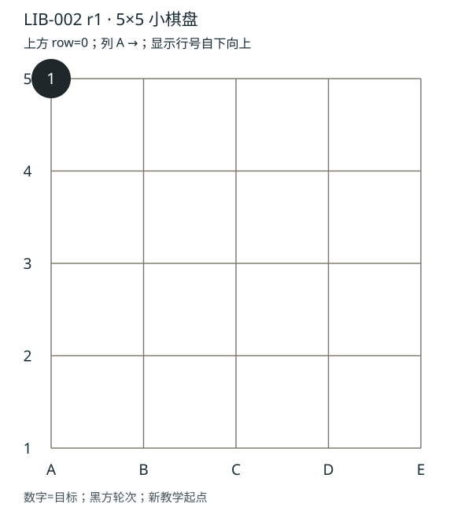

选出标记黑棋整块的全部气（liberties）。只回答，不落子。

完整坐标：黑：A5；白：无

条件：见完整棋盘；仅按题干即时或有限目标作答。

成功标准：点集合与全部气完全一致，无遗漏无多选；不判断活死。

### 答案与解释

气为 B5 A4，共 2 口。A5 已在完整棋盘角上；上方和左方没有交叉点。

### 三层提示

1. 沿线找上下左右相邻的空点。
2. 先找完整连通块，排除白子和斜角。
3. 把重复出现的同一空点合并后再数。

常见错误：把斜角、己子或重复空点算入气。

同伴讨论：若移到 A4，气的数量怎样改变？

建议难度：beginner。依据：从单子、边角到共享气逐步增加去重工作。

验证：结构、合法起点、已记载变化、适用答案目标与外部概念参考分别记录于 validation/results.json 的同 ID 条目。humanReviewed=null。未覆盖的合法手为 unknown。

## LIB-003  r1　连成一块一起数

完整 5×5 小棋盘练习　黑方轮次　新教学起点

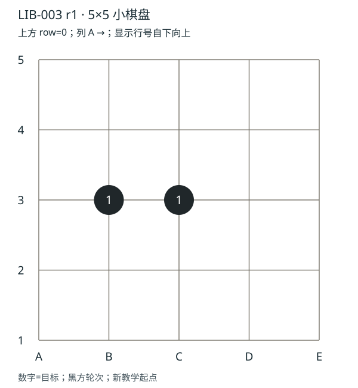

数出标记黑棋整块的全部气（liberties）。只回答，不落子。

完整坐标：黑：B3 C3；白：无

条件：见完整棋盘；仅按题干即时或有限目标作答。

成功标准：数字准确；不判断活死。

### 答案与解释

气为 B4 C4 A3 D3 B2 C2，共 6 口。两颗相连黑子互相占据的点不是气。

### 三层提示

1. 沿线找上下左右相邻的空点。
2. 先找完整连通块，排除白子和斜角。
3. 把重复出现的同一空点合并后再数。

常见错误：把斜角、己子或重复空点算入气。

同伴讨论：为什么不能把两个单子的四气直接相加？

建议难度：beginner。依据：从单子、边角到共享气逐步增加去重工作。

验证：结构、合法起点、已记载变化、适用答案目标与外部概念参考分别记录于 validation/results.json 的同 ID 条目。humanReviewed=null。未覆盖的合法手为 unknown。

## LIB-004  r1　折形的共享气

完整 5×5 小棋盘练习　黑方轮次　新教学起点

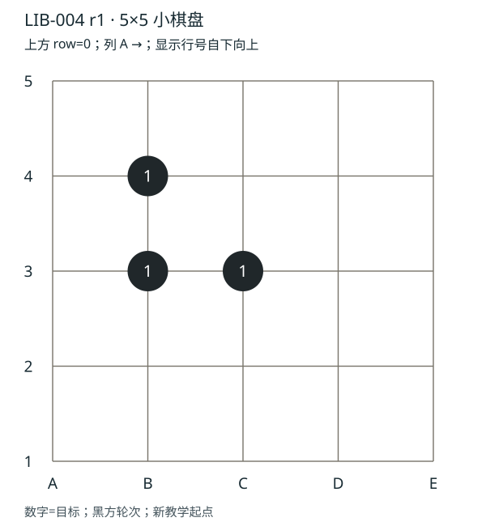

选出标记黑棋整块的全部气（liberties）。只回答，不落子。

完整坐标：黑：B4 B3 C3；白：无

条件：见完整棋盘；仅按题干即时或有限目标作答。

成功标准：点集合与全部气完全一致，无遗漏无多选；不判断活死。

### 答案与解释

气为 B5 A4 C4 A3 D3 B2 C2，共 7 口。C4 同时邻接 B4、C3，但同一个空点只计一次。

### 三层提示

1. 沿线找上下左右相邻的空点。
2. 先找完整连通块，排除白子和斜角。
3. 把重复出现的同一空点合并后再数。

常见错误：把斜角、己子或重复空点算入气。

同伴讨论：让一人数方向，另一人检查是否重复。

建议难度：beginner。依据：从单子、边角到共享气逐步增加去重工作。

验证：结构、合法起点、已记载变化、适用答案目标与外部概念参考分别记录于 validation/results.json 的同 ID 条目。humanReviewed=null。未覆盖的合法手为 unknown。

## LIB-005  r1　整块与敌子共同限制

完整 9×9 棋盘　黑方轮次　新教学起点

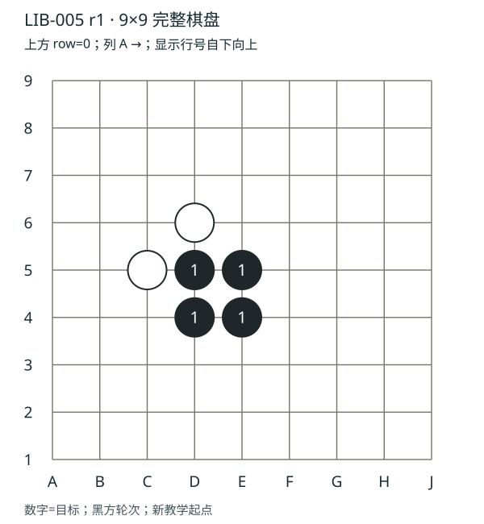

数出标记黑棋整块的全部气（liberties）。只回答，不落子。

完整坐标：黑：D5 E5 D4 E4；白：C5 D6

条件：见完整棋盘；仅按题干即时或有限目标作答。

成功标准：数字准确；不判断活死。

### 答案与解释

气为 E6 F5 C4 F4 D3 E3，共 6 口。C5、D6 已有白子，不能作为气；方块内部的棋子也不是空点。

### 三层提示

1. 沿线找上下左右相邻的空点。
2. 先找完整连通块，排除白子和斜角。
3. 把重复出现的同一空点合并后再数。

常见错误：把斜角、己子或重复空点算入气。

同伴讨论：若白下 E6，全块会少几口气？为什么？

建议难度：beginner。依据：从单子、边角到共享气逐步增加去重工作。

验证：结构、合法起点、已记载变化、适用答案目标与外部概念参考分别记录于 validation/results.json 的同 ID 条目。humanReviewed=null。未覆盖的合法手为 unknown。

## CAP-001  r1　补最后一口气

完整 5×5 小棋盘练习　黑方轮次　新教学起点

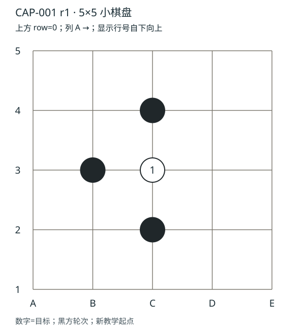

黑先。本手提掉全部标记白子（capture）；成功后立即结束本题。

完整坐标：黑：C4 B3 C2；白：C3

条件：见完整棋盘；仅按题干即时或有限目标作答。

成功标准：本手全部标记白子消失，不以面积或后续胜负判定。

### 答案与解释

D3 是 C3 白子的唯一气。黑 D3 后整颗白子被提走。
变化：黑D3（本题成功）；黑D4 → 白D3（本题未达标）

### 三层提示

1. 先检查目标块的全部气。
2. 比较候选点落下后，哪些棋子连接或被提走。
3. 在完整棋盘上重放一手，再按成功标准核对。

常见错误：黑 D4 未填最后一气；白 D3 后目标扩展并获得新气。

同伴讨论：先预测提子数，再由同伴实际移走整块核对。

建议难度：elementary。依据：一次局部决定，需区分即时目标与后续应对。

验证：结构、合法起点、已记载变化、适用答案目标与外部概念参考分别记录于 validation/results.json 的同 ID 条目。humanReviewed=null。未覆盖的合法手为 unknown。

## CAP-002  r1　沿边提掉整块

完整 5×5 小棋盘练习　黑方轮次　新教学起点

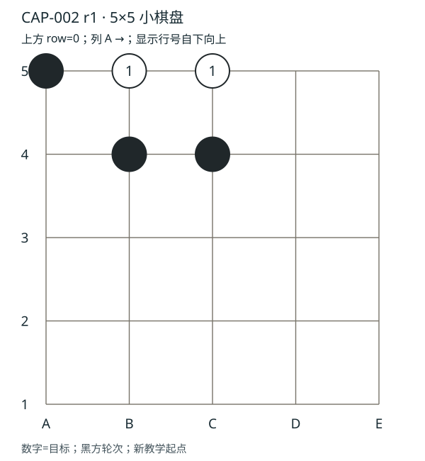

黑先。本手提掉全部标记白子（capture）；成功后立即结束本题。

完整坐标：黑：A5 B4 C4；白：B5 C5

条件：见完整棋盘；仅按题干即时或有限目标作答。

成功标准：本手全部标记白子消失，不以面积或后续胜负判定。

### 答案与解释

B5、C5 是同一块，唯一气是 D5。黑 D5 一手提掉两颗。
变化：黑D5（本题成功）；黑D4 → 白D5（本题未达标）

### 三层提示

1. 先检查目标块的全部气。
2. 比较候选点落下后，哪些棋子连接或被提走。
3. 在完整棋盘上重放一手，再按成功标准核对。

常见错误：黑 D4 没填 D5；白 D5 连接后可向 E5 等点延伸。

同伴讨论：先预测提子数，再由同伴实际移走整块核对。

建议难度：elementary。依据：一次局部决定，需区分即时目标与后续应对。

验证：结构、合法起点、已记载变化、适用答案目标与外部概念参考分别记录于 validation/results.json 的同 ID 条目。humanReviewed=null。未覆盖的合法手为 unknown。

## CAP-003  r1　边线方向少一条

完整 5×5 小棋盘练习　黑方轮次　新教学起点

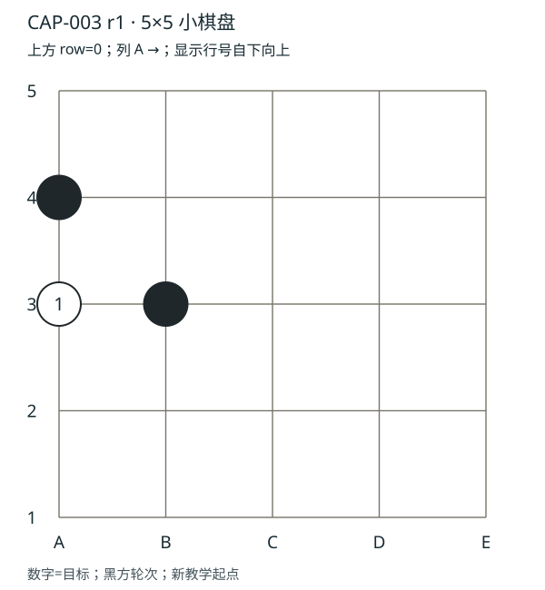

黑先。本手提掉全部标记白子（capture）；成功后立即结束本题。

完整坐标：黑：A4 B3；白：A3

条件：见完整棋盘；仅按题干即时或有限目标作答。

成功标准：本手全部标记白子消失，不以面积或后续胜负判定。

### 答案与解释

完整棋盘左边没有盘外一气。黑 A2 填最后一气，提走 A3。
变化：黑A2（本题成功）；黑C3 → 白A2（本题未达标）

### 三层提示

1. 先检查目标块的全部气。
2. 比较候选点落下后，哪些棋子连接或被提走。
3. 在完整棋盘上重放一手，再按成功标准核对。

常见错误：黑 C3 没有提到目标；白 A2 延伸，获得 A1、B2 等气。

同伴讨论：先预测提子数，再由同伴实际移走整块核对。

建议难度：elementary。依据：一次局部决定，需区分即时目标与后续应对。

验证：结构、合法起点、已记载变化、适用答案目标与外部概念参考分别记录于 validation/results.json 的同 ID 条目。humanReviewed=null。未覆盖的合法手为 unknown。

## CAP-004  r1　一手同时提两块

完整 5×5 小棋盘练习　黑方轮次　新教学起点

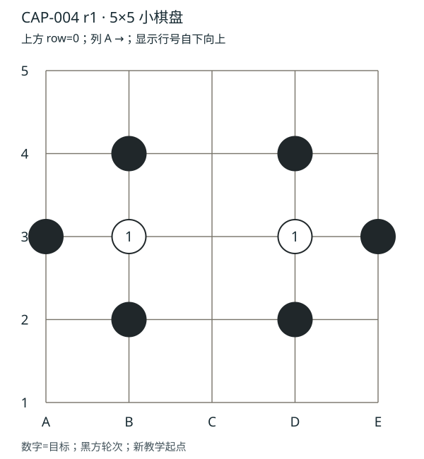

黑先。本手提掉全部标记白子（capture）；成功后立即结束本题。

完整坐标：黑：A3 B4 B2 E3 D4 D2；白：B3 D3

条件：见完整棋盘；仅按题干即时或有限目标作答。

成功标准：本手全部标记白子消失，不以面积或后续胜负判定。

### 答案与解释

B3 与 D3 是两块，但共同只剩 C3。黑 C3 同时提走两块。
变化：黑C3（本题成功）；黑C4 → 白C3（本题未达标）

### 三层提示

1. 先检查目标块的全部气。
2. 比较候选点落下后，哪些棋子连接或被提走。
3. 在完整棋盘上重放一手，再按成功标准核对。

常见错误：黑 C4 不是最后一气；白 C3 将两块接成一块并有 C2 一气。

同伴讨论：先预测提子数，再由同伴实际移走整块核对。

建议难度：elementary。依据：一次局部决定，需区分即时目标与后续应对。

验证：结构、合法起点、已记载变化、适用答案目标与外部概念参考分别记录于 validation/results.json 的同 ID 条目。humanReviewed=null。未覆盖的合法手为 unknown。

## CAP-005  r1　先提子再检查自杀

完整 5×5 小棋盘练习　黑方轮次　新教学起点

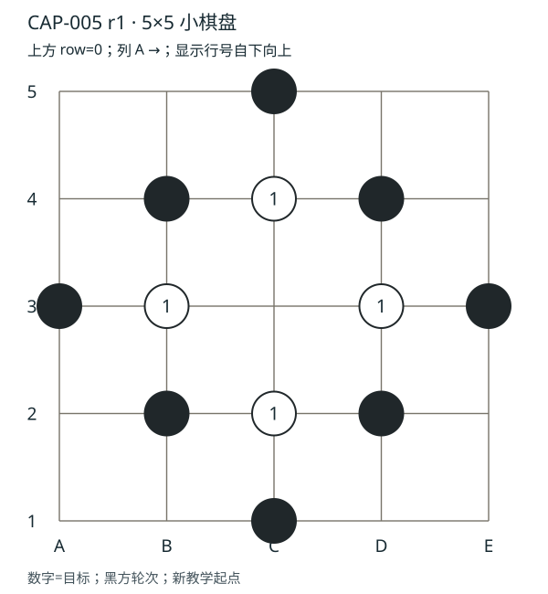

黑先。本手提掉全部标记白子（capture）；成功后立即结束本题。

完整坐标：黑：C5 B4 D4 A3 B2 E3 D2 C1；白：C4 B3 D3 C2

条件：见完整棋盘；仅按题干即时或有限目标作答。

成功标准：本手全部标记白子消失，不以面积或后续胜负判定。

### 答案与解释

四块白子各只剩 C3。黑 C3 先提掉四颗，随后获得四口气，因此合法。
变化：黑C3（本题成功）；黑A1 → 白A4（本题未达标）

### 三层提示

1. 先检查目标块的全部气。
2. 比较候选点落下后，哪些棋子连接或被提走。
3. 在完整棋盘上重放一手，再按成功标准核对。

常见错误：黑 A1 本手未提目标；白 A4 是合法的外侧施压，不能把未完成即时目标说成成功。

同伴讨论：先预测提子数，再由同伴实际移走整块核对。

建议难度：elementary。依据：一次局部决定，需区分即时目标与后续应对。

验证：结构、合法起点、已记载变化、适用答案目标与外部概念参考分别记录于 validation/results.json 的同 ID 条目。humanReviewed=null。未覆盖的合法手为 unknown。

## CON-001  r1　一间空点连接

完整 5×5 小棋盘练习　黑方轮次　新教学起点

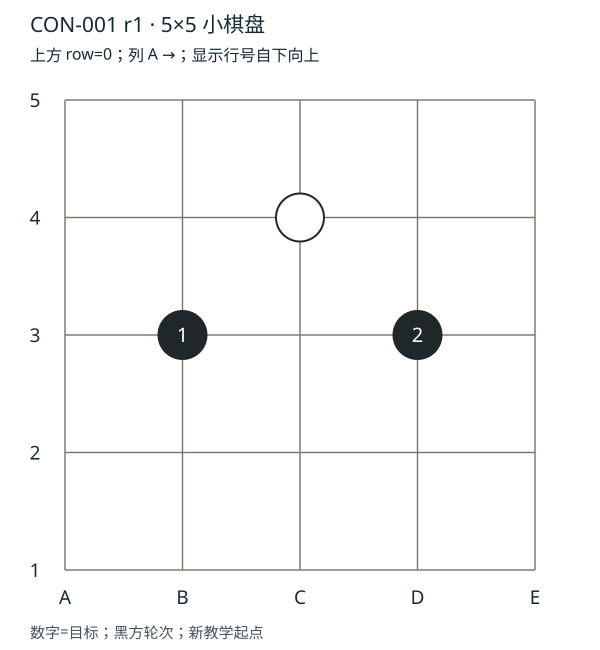

黑先。本手把两个标记目标连接（connection）为一块。

完整坐标：黑：B3 D3；白：C4

条件：见完整棋盘；仅按题干即时或有限目标作答。

成功标准：本手两目标仍在盘上且属于同一连通块。 不要求保证永久活棋。

### 答案与解释

黑 C3 与 B3、D3 正交相邻，三子成为一块。 这只证明本题即时目标，不证明永久活棋。
变化：黑C3（本题成功）；黑C2 → 白C3（本题未达标）

### 三层提示

1. 先检查目标块的全部气。
2. 比较候选点落下后，哪些棋子连接或被提走。
3. 在完整棋盘上重放一手，再按成功标准核对。

常见错误：黑 C2 与两目标都不直接相邻；白 C3 占住连接点。

同伴讨论：下一手对方可以在哪里施压？连接与永远安全有什么差别？

建议难度：elementary。依据：一次局部决定，需区分即时目标与后续应对。

验证：结构、合法起点、已记载变化、适用答案目标与外部概念参考分别记录于 validation/results.json 的同 ID 条目。humanReviewed=null。未覆盖的合法手为 unknown。

## CON-002  r1　斜邻有两条接法

完整 5×5 小棋盘练习　黑方轮次　新教学起点

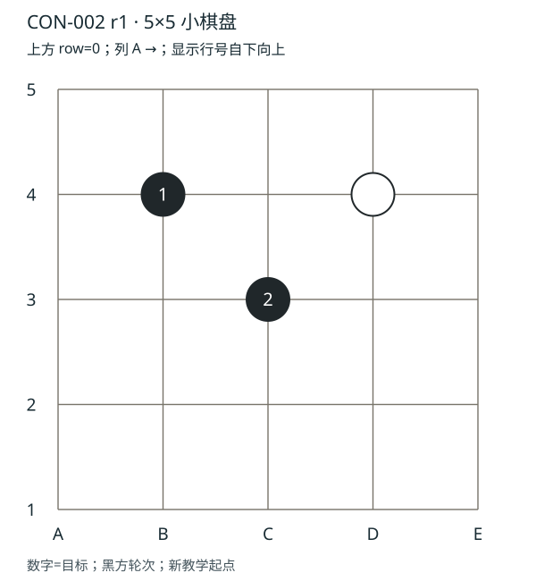

黑先。本手把两个标记目标连接（connection）为一块。

完整坐标：黑：B4 C3；白：D4

条件：见完整棋盘；仅按题干即时或有限目标作答。

成功标准：本手两目标仍在盘上且属于同一连通块。 不要求保证永久活棋。

### 答案与解释

黑 C4 或 B3 都同时邻接两目标，因此两手均接受。 这只证明本题即时目标，不证明永久活棋。
变化：黑C4（本题成功）；黑B3（本题成功）；黑A4 → 白B3（本题未达标）

### 三层提示

1. 先检查目标块的全部气。
2. 比较候选点落下后，哪些棋子连接或被提走。
3. 在完整棋盘上重放一手，再按成功标准核对。

常见错误：黑 A4 只接上 B4；白 B3 占住一种接法，C4 仍可连接，不能据此断言永远断开。

同伴讨论：下一手对方可以在哪里施压？连接与永远安全有什么差别？

建议难度：elementary。依据：一次局部决定，需区分即时目标与后续应对。

验证：结构、合法起点、已记载变化、适用答案目标与外部概念参考分别记录于 validation/results.json 的同 ID 条目。humanReviewed=null。未覆盖的合法手为 unknown。

## CON-003  r1　打吃时向外延伸

完整 5×5 小棋盘练习　黑方轮次　新教学起点

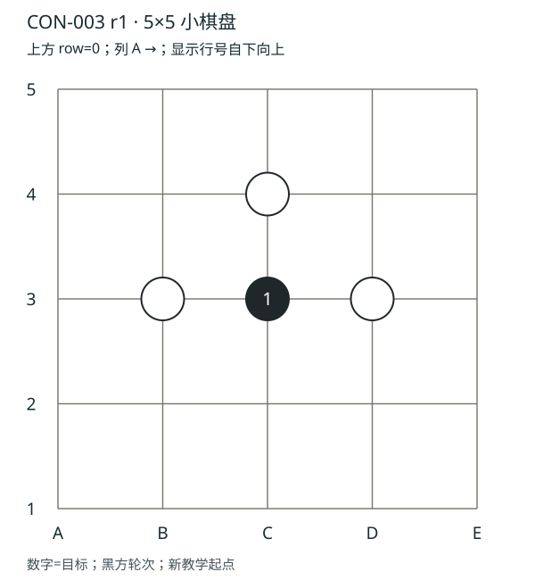

黑先。本手救出被打吃（atari）的目标，使其至少有两口气。

完整坐标：黑：C3；白：B3 C4 D3

条件：见完整棋盘；仅按题干即时或有限目标作答。

成功标准：本手目标仍在，所在块至少有两口气。 不要求保证永久活棋。

### 答案与解释

目标原仅 C2 一气。黑 C2 后整块有 B2、D2、C1 三口气，已解除当前打吃。 这只证明本题即时目标，不证明永久活棋。
变化：黑C2（本题成功）；黑A1 → 白C2（本题未达标）

### 三层提示

1. 先检查目标块的全部气。
2. 比较候选点落下后，哪些棋子连接或被提走。
3. 在完整棋盘上重放一手，再按成功标准核对。

常见错误：黑 A1 离开目标，白 C2 可立即提掉 C3。

同伴讨论：下一手对方可以在哪里施压？连接与永远安全有什么差别？

建议难度：elementary。依据：一次局部决定，需区分即时目标与后续应对。

验证：结构、合法起点、已记载变化、适用答案目标与外部概念参考分别记录于 validation/results.json 的同 ID 条目。humanReviewed=null。未覆盖的合法手为 unknown。

## CON-004  r1　边上搭桥

完整 5×5 小棋盘练习　黑方轮次　新教学起点

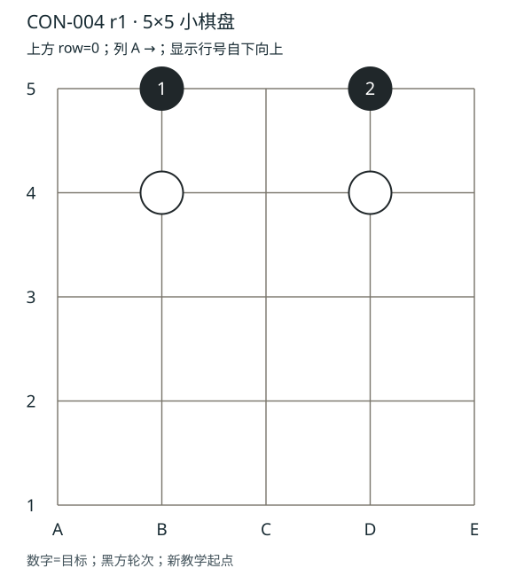

黑先。本手把两个标记目标连接（connection）为一块。

完整坐标：黑：B5 D5；白：B4 D4

条件：见完整棋盘；仅按题干即时或有限目标作答。

成功标准：本手两目标仍在盘上且属于同一连通块。 不要求保证永久活棋。

### 答案与解释

黑 C5 把两边的黑子接为一块，剩 A5、E5、C4 三口气。 这只证明本题即时目标，不证明永久活棋。
变化：黑C5（本题成功）；黑A4 → 白C5（本题未达标）

### 三层提示

1. 先检查目标块的全部气。
2. 比较候选点落下后，哪些棋子连接或被提走。
3. 在完整棋盘上重放一手，再按成功标准核对。

常见错误：黑 A4 没有接通两目标；白 C5 可合法占住桥点。

同伴讨论：下一手对方可以在哪里施压？连接与永远安全有什么差别？

建议难度：elementary。依据：一次局部决定，需区分即时目标与后续应对。

验证：结构、合法起点、已记载变化、适用答案目标与外部概念参考分别记录于 validation/results.json 的同 ID 条目。humanReviewed=null。未覆盖的合法手为 unknown。

## CON-005  r1　逃跑同时接到同伴

完整 5×5 小棋盘练习　黑方轮次　新教学起点

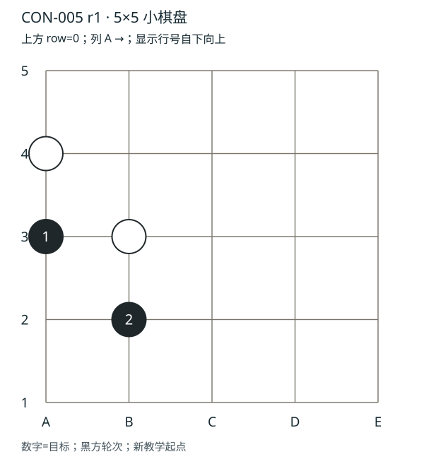

黑先。本手把两个标记目标连接（connection）为一块。

完整坐标：黑：A3 B2；白：A4 B3

条件：见完整棋盘；仅按题干即时或有限目标作答。

成功标准：本手两目标仍在盘上且属于同一连通块。 不要求保证永久活棋。

### 答案与解释

A3 仅 A2 一气。黑 A2 同时连接 B2，整块有 A1、B1、C2 三口气。 这只证明本题即时目标，不证明永久活棋。
变化：黑A2（本题成功）；黑C2 → 白A2（本题未达标）

### 三层提示

1. 先检查目标块的全部气。
2. 比较候选点落下后，哪些棋子连接或被提走。
3. 在完整棋盘上重放一手，再按成功标准核对。

常见错误：黑 C2 虽加厚 B2，却没有救 A3；白 A2 立即提走 A3。

同伴讨论：下一手对方可以在哪里施压？连接与永远安全有什么差别？

建议难度：elementary。依据：一次局部决定，需区分即时目标与后续应对。

验证：结构、合法起点、已记载变化、适用答案目标与外部概念参考分别记录于 validation/results.json 的同 ID 条目。humanReviewed=null。未覆盖的合法手为 unknown。

## LIFE-001  r1　两个独立真眼

完整 5×5 小棋盘练习　白方轮次　新教学起点

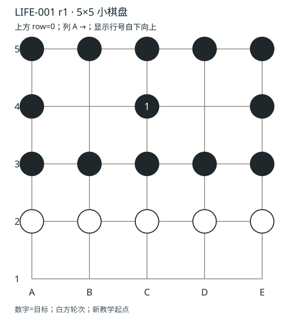

白方轮次。标出黑棋两个独立真眼（true eyes）的空点。只选点，不落子。

完整坐标：黑：A5 B5 C5 D5 E5 A4 C4 E4 A3 B3 C3 D3 E3；白：A2 B2 C2 D2 E2

条件：见完整棋盘；仅按题干即时或有限目标作答。

成功标准：恰好选择 B4、D4；理解证明适用于黑不自毁眼形。

### 答案与解释

B4、D4 各自是独立单点空区，全部邻点属于同一个黑连通块。白先填任一眼，黑块仍有另一眼，不能被提；白新子无气，故自杀禁止。外部落子不能把已有黑子拆开。黑不主动填自己的眼时，白无法开始合法的最后提子。这是充分结构论证，不把两眼说成所有活棋的必要条件。

### 三层提示

1. 两个空点是否彼此相通？
2. 检查每个空点的所有正交邻点属于哪一块。
3. 白若先填一眼，黑块是否仍保有另一眼？

常见错误：把两个相连空点算两眼，或忽略眼壁属于不同、可被提的棋块。

同伴讨论：试解释“假设第一次提掉这块黑棋”为什么会矛盾。

建议难度：elementary。依据：单一完整黑块与两个互不连通单点眼，避开劫和双活。

验证：结构、合法起点、已记载变化、适用答案目标与外部概念参考分别记录于 validation/results.json 的同 ID 条目。humanReviewed=null。未覆盖的合法手为 unknown。

## LIFE-002  r1　看似眼的点可以被吃进

完整 5×5 小棋盘练习　白方轮次　新教学起点

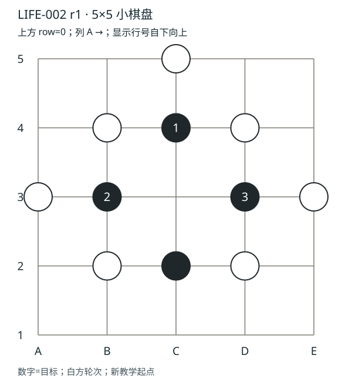

白先。本手提掉标记的三颗黑子，说明 C3 为什么是假眼（false eye）。

完整坐标：黑：C4 B3 D3 C2；白：B4 D4 B2 D2 C5 A3 E3

条件：见完整棋盘；仅按题干即时或有限目标作答。

成功标准：白本手提掉三颗标记黑子；只证伪这个眼，不判断其他黑棋的全盘死活。

### 答案与解释

白 C3 同时提掉 C4、B3、D3 三块，因而获得气。三块眼壁原来各只剩 C3；空点看似被黑包住，却可合法吃进。与 LIFE-001 的同块两眼结构不同。
变化：白C3（本题成功）；白A1 → 黑C1（本题未达标）

### 三层提示

1. 先检查目标块的全部气。
2. 比较候选点落下后，哪些棋子连接或被提走。
3. 在完整棋盘上重放一手，再按成功标准核对。

常见错误：白 A1 没提掉目标；黑 C1 可延长下方黑块，但没有让上方三个目标从最初就成为真眼。

同伴讨论：比较 LIFE-001：仅看围住空点的颜色，漏掉了什么？

建议难度：elementary。依据：一次局部决定，需区分即时目标与后续应对。

验证：结构、合法起点、已记载变化、适用答案目标与外部概念参考分别记录于 validation/results.json 的同 ID 条目。humanReviewed=null。未覆盖的合法手为 unknown。

## LIFE-003  r1　先手把三点空间分开

完整 5×5 小棋盘练习　黑方轮次　新教学起点

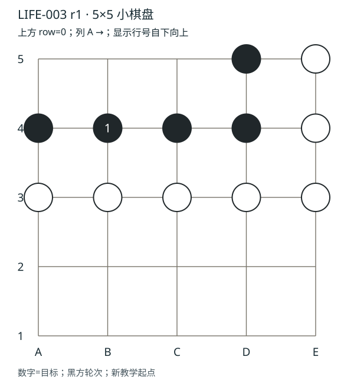

黑先。在 A5、B5、C5 的空间内，本手做出两个独立单点真眼。

完整坐标：黑：D5 A4 B4 C4 D4；白：E5 E4 A3 B3 C3 D3 E3

条件：见完整棋盘；仅按题干即时或有限目标作答。

成功标准：本手产生两个被同一黑块包围的独立单点空区。

### 答案与解释

黑 B5 接上 B4，把空间分为 A5、C5 两个单点眼。每个眼的邻接黑子都在同一块，另一眼使白不能合法吃进，黑不自填眼即可保有此两眼结构。
变化：黑B5（本题成功）；黑A5 → 白B5 → 黑C5 → 白B5（本题未达标）

### 三层提示

1. 先检查目标块的全部气。
2. 比较候选点落下后，哪些棋子连接或被提走。
3. 在完整棋盘上重放一手，再按成功标准核对。

常见错误：黑 A5 后剩 B5、C5 相连，仍只有一个空间。白 B5，黑 C5 提白，白再 B5 可提掉原黑块；末手与之前布局不同，不是劫。

同伴讨论：为什么中点与端点虽然都在内部，结果却不同？

建议难度：elementary。依据：一次局部决定，需区分即时目标与后续应对。

验证：结构、合法起点、已记载变化、适用答案目标与外部概念参考分别记录于 validation/results.json 的同 ID 条目。humanReviewed=null。未覆盖的合法手为 unknown。

## LIFE-004  r1　四点空间的防守要点

完整 5×5 小棋盘练习　黑方轮次　新教学起点

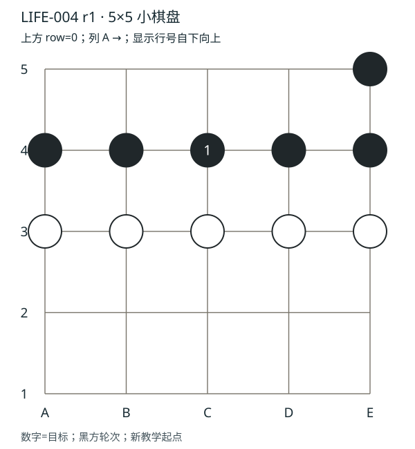

黑先。在 A5–D5 的空间内，本手分出两个独立眼区。较大眼区可有两点。

完整坐标：黑：E5 A4 B4 C4 D4 E4；白：A3 B3 C3 D3 E3

条件：见完整棋盘；仅按题干即时或有限目标作答。

成功标准：本手在指定空间形成大小 1 与 2 的两个空区，所有边界棋子同属目标黑块。

### 答案与解释

黑 B5 或 C5 均把四点直线分为单点眼与两点眼区。以 B5 为例，白 C5 后黑 D5 提白；白 D5 后黑 C5 提白。单点眼保住黑块，及时提掉侵入子可保持另一眼区。C5 首手完全对称。
变化：黑B5（本题成功）；黑C5（本题成功）；黑A5 → 白C5（本题未达标）

### 三层提示

1. 先检查目标块的全部气。
2. 比较候选点落下后，哪些棋子连接或被提走。
3. 在完整棋盘上重放一手，再按成功标准核对。

常见错误：黑 A5 后剩 B5–D5 一个连通空间，本手没有分眼；白 C5 抢占中点。此变化不作全盘死亡证明。

同伴讨论：对手从较大眼的另一端进入，你能交换应对点吗？

建议难度：elementary。依据：一次局部决定，需区分即时目标与后续应对。

补充合法变化：
- 黑B5 → 白C5 → 黑D5：提掉侵入的单颗白子，单点眼仍在。
- 黑B5 → 白D5 → 黑C5：提掉侵入的单颗白子，单点眼仍在。
- 黑C5 → 白A5 → 黑B5：提掉侵入的单颗白子，单点眼仍在。
- 黑C5 → 白B5 → 黑A5：提掉侵入的单颗白子，单点眼仍在。

验证：结构、合法起点、已记载变化、适用答案目标与外部概念参考分别记录于 validation/results.json 的同 ID 条目。humanReviewed=null。未覆盖的合法手为 unknown。

## LIFE-005  r1　两点相连仍是一个眼区

完整 5×5 小棋盘练习　白方轮次　新教学起点

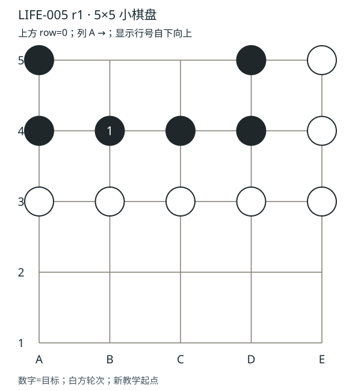

白先。在最多三手（白、黑、白）内提掉标记黑块。B5、C5 是一个相连空间。

完整坐标：黑：A5 D5 A4 B4 C4 D4；白：E5 E4 A3 B3 C3 D3 E3

条件：见完整棋盘；仅按题干即时或有限目标作答。

成功标准：无论合法黑回应为何，白在第三手或之前使全部原目标黑子消失。

### 答案与解释

白 B5 或 C5 均可。若黑占另一空点提白，白回到原点提掉整块；若黑下别处或停手，白占另一空点直接提掉目标。两点并非两个独立真眼。验证遍历本完整 5×5 的所有合法黑回应，终止于目标消失或三手界限；不是通用死活求解器。
变化：白B5 → 黑C5 → 白B5（本题成功）；白C5 → 黑B5 → 白C5（本题成功）

### 三层提示

1. 先检查目标块的全部气。
2. 比较候选点落下后，哪些棋子连接或被提走。
3. 在完整棋盘上重放一手，再按成功标准核对。

常见错误：只数两个空点就宣布活棋，或把每次回提都当作劫。这里回提后的整盘黑子数不同，布局不会相同。

同伴讨论：把“黑提一颗白子”和“白随后提掉整块”逐步摆出，比较两个完整棋盘。

建议难度：optional-challenge。依据：一次局部决定，需区分即时目标与后续应对。

验证：结构、合法起点、已记载变化、适用答案目标与外部概念参考分别记录于 validation/results.json 的同 ID 条目。humanReviewed=null。未覆盖的合法手为 unknown。

## AREA-001  r1　清楚围空：子与空都计入

完整 5×5 小棋盘练习　黑方轮次　新教学起点

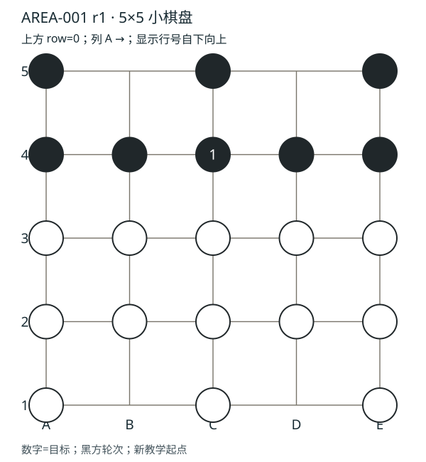

黑方的面积是多少？按给定教学假设计算。

完整坐标：黑：A5 C5 E5 A4 B4 C4 D4 E4；白：A3 B3 C3 D3 E3 A2 B2 C2 D2 E2 A1 C1 E1

条件：真实完整 5×5 小棋盘练习；新教学起点，过去劫史未知。 这是给定存活与死子约定的教学算例，不是某场已确认实战记录。 除明确标记死子外，盘上棋子按活子计算。提子数不额外计入面积。

成功标准：数字为 10。

### 答案与解释

黑活子 8 + 黑围空 2 = 10。白活子 13 + 白围空 2 + 贴目 0 = 15。中立 0 点不归双方。盘面核对：活子与三类空点合计 25。

### 三层提示

1. 先读题干的死子、中立点与贴目约定。
2. 分别数活子和围住的空点；中立点留空。
3. 核对是否多加了提子账本，或漏了白方贴目。

常见错误：漏算活子、把提子账本再次相加，或把中立区分给一方。

同伴讨论：一人逐点标空区，另一人核对活子，最后检查总和是否覆盖全盘。

建议难度：beginner。依据：明确教学约定下逐项核对面积，不使用未完棋局估算。

验证：结构、合法起点、已记载变化、适用答案目标与外部概念参考分别记录于 validation/results.json 的同 ID 条目。humanReviewed=null。未覆盖的合法手为 unknown。

## AREA-002  r1　中立空区：不分给任何一方

完整 5×5 小棋盘练习　黑方轮次　新教学起点

把所有空点标为黑围空、白围空或中立（neutral）。按给定教学假设回答。

完整坐标：黑：A5 C5 E5 A4 B4 C4 D4 E4；白：A2 B2 C2 D2 E2 A1 C1 E1

条件：真实完整 5×5 小棋盘练习；新教学起点，过去劫史未知。 中间整行混合接触黑白边界，按本教学约定保留为中立区；这是计分假设，并不主张实战已经收完。 这是给定存活与死子约定的教学算例，不是某场已确认实战记录。 除明确标记死子外，盘上棋子按活子计算。提子数不额外计入面积。

成功标准：恰好标记全部 9 个空点，所属方全部正确。

### 答案与解释

黑活子 8 + 黑围空 2 = 10。白活子 8 + 白围空 2 + 贴目 0 = 10。中立 5 点不归双方。盘面核对：活子与三类空点合计 25。
逐点答案：B5=黑围空；D5=黑围空；B1=白围空；D1=白围空；A3=中立；B3=中立；C3=中立；D3=中立；E3=中立。

### 三层提示

1. 先读题干的死子、中立点与贴目约定。
2. 分别数活子和围住的空点；中立点留空。
3. 核对是否多加了提子账本，或漏了白方贴目。

常见错误：漏算活子、把提子账本再次相加，或把中立区分给一方。

同伴讨论：一人逐点标空区，另一人核对活子，最后检查总和是否覆盖全盘。

建议难度：beginner。依据：明确教学约定下逐项核对面积，不使用未完棋局估算。

验证：结构、合法起点、已记载变化、适用答案目标与外部概念参考分别记录于 validation/results.json 的同 ID 条目。humanReviewed=null。未覆盖的合法手为 unknown。

## AREA-003  r1　确认死子后再计算

完整 5×5 小棋盘练习　黑方轮次　新教学起点

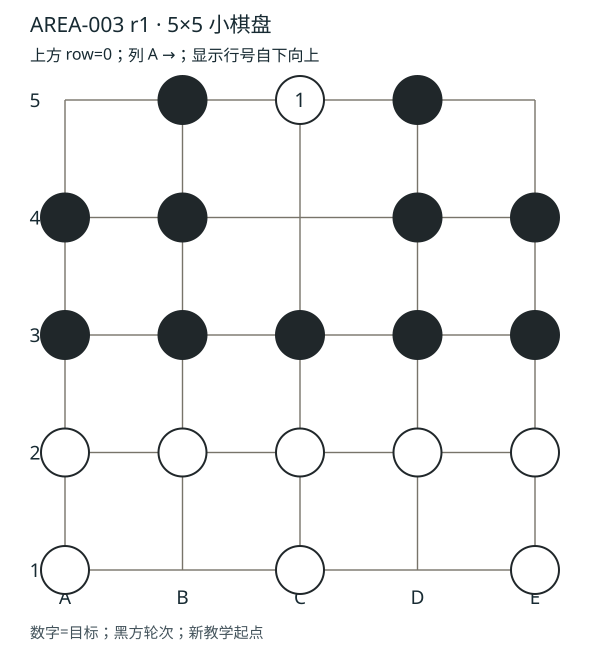

按“C5 白子已被双方同意为死子”的教学假设，移除后黑方面积是多少？

完整坐标：黑：B5 D5 A4 B4 D4 E4 A3 B3 C3 D3 E3；白：A2 B2 C2 D2 E2 A1 C1 E1 C5

条件：真实完整 5×5 小棋盘练习；新教学起点，过去劫史未知。 教学假设双方已同意 C5 白子为死子，移除其完整一子块。此处不伪造真实双方确认。 可实际演示黑 C4 提掉 C5；该演示是新教学起点的合法变化。 这是给定存活与死子约定的教学算例，不是某场已确认实战记录。 除明确标记死子外，盘上棋子按活子计算。提子数不额外计入面积。

成功标准：数字为 15；理解死子移除与真实落子演示是两种不同操作。

### 答案与解释

黑活子 11 + 黑围空 4 = 15。白活子 8 + 白围空 2 + 贴目 0 = 10。中立 0 点不归双方。盘面核对：活子与三类空点合计 25。 C5 移除后是黑方围空之一，不作为提子另加分。

### 三层提示

1. 先读题干的死子、中立点与贴目约定。
2. 分别数活子和围住的空点；中立点留空。
3. 核对是否多加了提子账本，或漏了白方贴目。

常见错误：漏算活子、把提子账本再次相加，或把中立区分给一方。

同伴讨论：一人逐点标空区，另一人核对活子，最后检查总和是否覆盖全盘。

建议难度：beginner。依据：明确教学约定下逐项核对面积，不使用未完棋局估算。

验证：结构、合法起点、已记载变化、适用答案目标与外部概念参考分别记录于 validation/results.json 的同 ID 条目。humanReviewed=null。未覆盖的合法手为 unknown。

## AREA-004  r1　贴目变化：同一面积不同结果

完整 5×5 小棋盘练习　黑方轮次　新教学起点

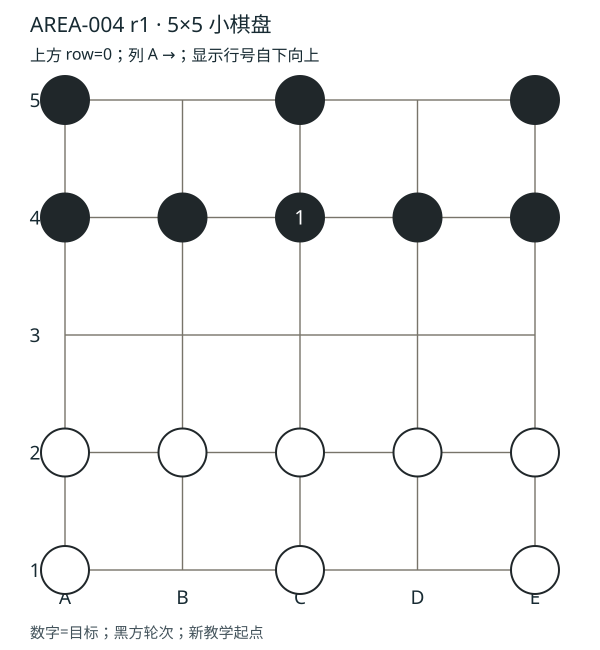

本例开局贴目（komi）为 0.5，白方总分是多少？

完整坐标：黑：A5 C5 E5 A4 B4 C4 D4 E4；白：A2 B2 C2 D2 E2 A1 C1 E1

条件：真实完整 5×5 小棋盘练习；新教学起点，过去劫史未知。 主算例开局贴目为 0.5。另开教学情境比较 0 与 2.5，不在已开始的同一局中途改贴目。 中间整行按教学约定保留中立；0、0.5、2.5 都只是教学参数，不是官方小棋盘标准。 这是给定存活与死子约定的教学算例，不是某场已确认实战记录。 除明确标记死子外，盘上棋子按活子计算。提子数不额外计入面积。

成功标准：数字为 10.5；只在白方加开局贴目。

### 答案与解释

黑活子 8 + 黑围空 2 = 10。白活子 8 + 白围空 2 + 贴目 0.5 = 10.5。中立 5 点不归双方。盘面核对：活子与三类空点合计 25。

### 三层提示

1. 先读题干的死子、中立点与贴目约定。
2. 分别数活子和围住的空点；中立点留空。
3. 核对是否多加了提子账本，或漏了白方贴目。

常见错误：漏算活子、把提子账本再次相加，或把中立区分给一方。

同伴讨论：一人逐点标空区，另一人核对活子，最后检查总和是否覆盖全盘。

建议难度：beginner。依据：明确教学约定下逐项核对面积，不使用未完棋局估算。

验证：结构、合法起点、已记载变化、适用答案目标与外部概念参考分别记录于 validation/results.json 的同 ID 条目。humanReviewed=null。未覆盖的合法手为 unknown。

## AREA-005  r1　提子更多也不额外加分

完整 5×5 小棋盘练习　黑方轮次　新教学起点

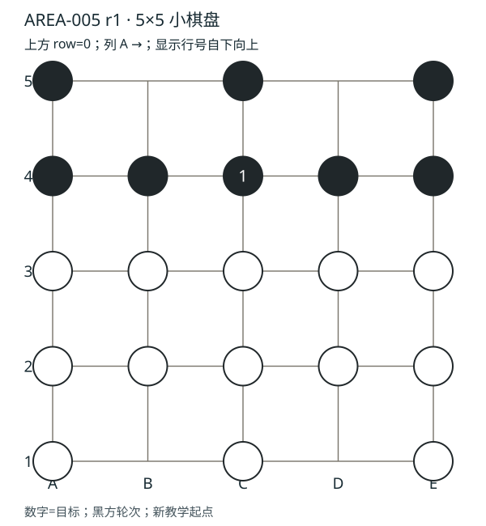

反事实提子账本写着黑提 12、白提 1。按面积计分（area scoring），哪种说法正确？

完整坐标：黑：A5 C5 E5 A4 B4 C4 D4 E4；白：A3 B3 C3 D3 E3 A2 B2 C2 D2 E2 A1 C1 E1

条件：真实完整 5×5 小棋盘练习；新教学起点，过去劫史未知。 B=12、W=1 只是反事实比较用的提子账本标签，不是重建或声称存在这样的历史棋谱。把标签换成 B=0、W=0，面积计算仍相同。 这是给定存活与死子约定的教学算例，不是某场已确认实战记录。 除明确标记死子外，盘上棋子按活子计算。提子数不额外计入面积。

成功标准：只选 area，并能指出活子加围空的公式。

### 答案与解释

黑活子 8 + 黑围空 2 = 10。白活子 13 + 白围空 2 + 贴目 0 = 15。中立 0 点不归双方。盘面核对：活子与三类空点合计 25。 提子账本 B=12、W=1 不参与公式，白仍多 5 分。

### 三层提示

1. 先读题干的死子、中立点与贴目约定。
2. 分别数活子和围住的空点；中立点留空。
3. 核对是否多加了提子账本，或漏了白方贴目。

常见错误：漏算活子、把提子账本再次相加，或把中立区分给一方。

同伴讨论：一人逐点标空区，另一人核对活子，最后检查总和是否覆盖全盘。

建议难度：beginner。依据：明确教学约定下逐项核对面积，不使用未完棋局估算。

验证：结构、合法起点、已记载变化、适用答案目标与外部概念参考分别记录于 validation/results.json 的同 ID 条目。humanReviewed=null。未覆盖的合法手为 unknown。

## DISC-001  r1　连接还是向空处发展

完整 9×9 棋盘　黑方轮次　新教学起点

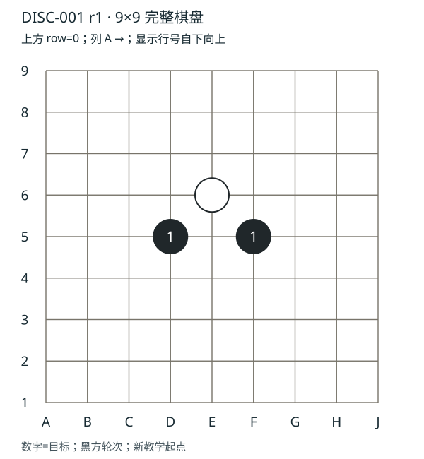

黑先，比较 E5 连接与 C3 向空处发展。提出自己的选择和对方回应，不要求最佳手。

完整坐标：黑：D5 F5；白：E6

条件：见完整棋盘；仅按题干即时或有限目标作答。

成功标准：同伴观察到有依据、有回应、有倾听的讨论即可；不自动判文本对错。

### 答案与解释

候选只是讨论起点，不列唯一最佳手。反馈关注依据、回应与倾听；有新候选也按同一量规讨论。
E5 立即把两子连通；白 E4 从下方接近。取舍是连接稳妥，但黑暂未在左下扩展。
C3 在左下留下据点；白 E5 占住两黑子间的点。取舍是空间与连接需求。

### 三层提示

1. 先任选一个候选，说出它立即改变什么。
2. 替对手找一个合法回应，不只看自己。
3. 比较得到了什么、放弃了什么，再听同伴的理由。

常见错误：把作者示例当唯一答案，或用输赢给个人价值打分。

同伴讨论：请先准确复述同伴的选择理由，再说明你是否改变想法。

建议难度：elementary。依据：开放权衡，局部合法变化易于重放，不要求计算全盘最优。

开放量规：
- 能引用具体坐标、气或连接关系说明自己的目标。
- 能提出至少一个合法对方回应，并说明选择的代价。
- 能复述同伴的一项依据，说明自己保留或调整想法的原因。

验证：结构、合法起点、已记载变化、适用答案目标与外部概念参考分别记录于 validation/results.json 的同 ID 条目。humanReviewed=null。未覆盖的合法手为 unknown。

## DISC-002  r1　救一颗子与改变方向

完整 9×9 棋盘　黑方轮次　新教学起点

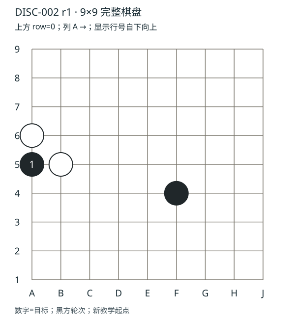

黑先，比较 A4 救出 A5 与 E5 改变发展方向。允许选择放弃一子，但须说清代价。

完整坐标：黑：A5 F4；白：A6 B5

条件：见完整棋盘；仅按题干即时或有限目标作答。

成功标准：同伴观察到有依据、有回应、有倾听的讨论即可；不自动判文本对错。

### 答案与解释

候选只是讨论起点，不列唯一最佳手。反馈关注依据、回应与倾听；有新候选也按同一量规讨论。
A4 使 A5 延伸到两气以上；白 B4 继续施压。取舍是保留目标但局部仍需注意。
E5 向中心发展；白 A4 提掉 A5。取舍是接受明确的一子损失，不可称它也救了目标。

### 三层提示

1. 先任选一个候选，说出它立即改变什么。
2. 替对手找一个合法回应，不只看自己。
3. 比较得到了什么、放弃了什么，再听同伴的理由。

常见错误：把作者示例当唯一答案，或用输赢给个人价值打分。

同伴讨论：请先准确复述同伴的选择理由，再说明你是否改变想法。

建议难度：elementary。依据：开放权衡，局部合法变化易于重放，不要求计算全盘最优。

开放量规：
- 能引用具体坐标、气或连接关系说明自己的目标。
- 能提出至少一个合法对方回应，并说明选择的代价。
- 能复述同伴的一项依据，说明自己保留或调整想法的原因。

验证：结构、合法起点、已记载变化、适用答案目标与外部概念参考分别记录于 validation/results.json 的同 ID 条目。humanReviewed=null。未覆盖的合法手为 unknown。

## DISC-003  r1　十三路上的两种距离

完整 13×13 棋盘　黑方轮次　新教学起点

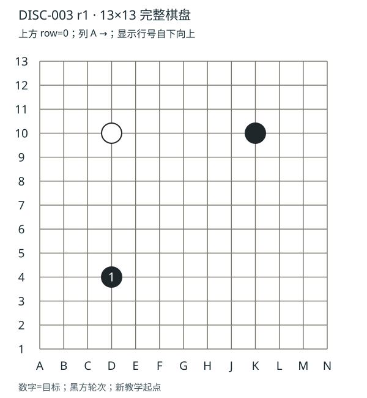

黑先，在完整 13×13 比较 D6 与 K4。分别说明与已有棋子的距离、目标和白方回应。

完整坐标：黑：D4 K10；白：D10

条件：见完整棋盘；仅按题干即时或有限目标作答。

成功标准：同伴观察到有依据、有回应、有倾听的讨论即可；不自动判文本对错。

### 答案与解释

候选只是讨论起点，不列唯一最佳手。反馈关注依据、回应与倾听；有新候选也按同一量规讨论。
D6 靠近 D4，但隔着 D5，尚未正交连成一块；白 E6 可以接近。取舍是局部协作与覆盖范围。
K4 在右下发展；白 J4 可接近。取舍是更分散，左侧黑子暂未得到直接连接。

### 三层提示

1. 先任选一个候选，说出它立即改变什么。
2. 替对手找一个合法回应，不只看自己。
3. 比较得到了什么、放弃了什么，再听同伴的理由。

常见错误：把作者示例当唯一答案，或用输赢给个人价值打分。

同伴讨论：请先准确复述同伴的选择理由，再说明你是否改变想法。

建议难度：elementary。依据：开放权衡，局部合法变化易于重放，不要求计算全盘最优。

开放量规：
- 能引用具体坐标、气或连接关系说明自己的目标。
- 能提出至少一个合法对方回应，并说明选择的代价。
- 能复述同伴的一项依据，说明自己保留或调整想法的原因。

验证：结构、合法起点、已记载变化、适用答案目标与外部概念参考分别记录于 validation/results.json 的同 ID 条目。humanReviewed=null。未覆盖的合法手为 unknown。

## DISC-004  r1　提子还是先连接

完整 9×9 棋盘　黑方轮次　新教学起点

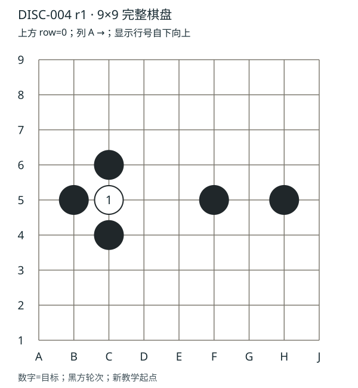

黑先，比较 D5 提掉 C5 白子与 G5 连接 F5、H5。先预测双方一手，再交流取舍。

完整坐标：黑：C6 B5 C4 F5 H5；白：C5

条件：见完整棋盘；仅按题干即时或有限目标作答。

成功标准：同伴观察到有依据、有回应、有倾听的讨论即可；不自动判文本对错。

### 答案与解释

候选只是讨论起点，不列唯一最佳手。反馈关注依据、回应与倾听；有新候选也按同一量规讨论。
D5 立即提掉 C5 白子；白 G5 可占黑棋连接点。取舍是局部收益与另一处连接。
G5 先连接右方两子；白 D5 救出 C5。取舍是放过本来的一手提子机会。

### 三层提示

1. 先任选一个候选，说出它立即改变什么。
2. 替对手找一个合法回应，不只看自己。
3. 比较得到了什么、放弃了什么，再听同伴的理由。

常见错误：把作者示例当唯一答案，或用输赢给个人价值打分。

同伴讨论：请先准确复述同伴的选择理由，再说明你是否改变想法。

建议难度：elementary。依据：开放权衡，局部合法变化易于重放，不要求计算全盘最优。

开放量规：
- 能引用具体坐标、气或连接关系说明自己的目标。
- 能提出至少一个合法对方回应，并说明选择的代价。
- 能复述同伴的一项依据，说明自己保留或调整想法的原因。

验证：结构、合法起点、已记载变化、适用答案目标与外部概念参考分别记录于 validation/results.json 的同 ID 条目。humanReviewed=null。未覆盖的合法手为 unknown。

## DISC-005  r1　停手前先核对争议

完整 9×9 棋盘　黑方轮次　新教学起点

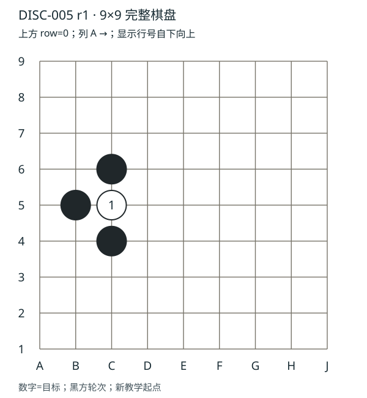

黑方轮次，局面尚未结束。比较 D5 实际提子与停一手。怎样与同伴核对争议？

完整坐标：黑：C6 B5 C4；白：C5

条件：见完整棋盘；仅按题干即时或有限目标作答。

成功标准：同伴观察到有依据、有回应、有倾听的讨论即可；不自动判文本对错。

### 答案与解释

候选只是讨论起点，不列唯一最佳手。反馈关注依据、回应与倾听；有新候选也按同一量规讨论。
黑 D5 实际提掉 C5，白 E5 可继续下。此局仍有大片未定空间，不把这一提当全局结束。
黑停一手后白 D5 可以延伸救子。停手本身合法，但没有解决目标状态，更没有自动移除白子。

### 三层提示

1. 先任选一个候选，说出它立即改变什么。
2. 替对手找一个合法回应，不只看自己。
3. 比较得到了什么、放弃了什么，再听同伴的理由。

常见错误：把作者示例当唯一答案，或用输赢给个人价值打分。

同伴讨论：请先准确复述同伴的选择理由，再说明你是否改变想法。

建议难度：elementary。依据：开放权衡，局部合法变化易于重放，不要求计算全盘最优。

开放量规：
- 能引用具体坐标、气或连接关系说明自己的目标。
- 能提出至少一个合法对方回应，并说明选择的代价。
- 能复述同伴的一项依据，说明自己保留或调整想法的原因。

验证：结构、合法起点、已记载变化、适用答案目标与外部概念参考分别记录于 validation/results.json 的同 ID 条目。humanReviewed=null。未覆盖的合法手为 unknown。

## END-001  r1　清楚围空：子与空都计入

完整 5×5 小棋盘练习　黑方轮次　明确教学假设

请按本例状态与假设判断，再逐项核对。

完整坐标：黑：A5 C5 E5 A4 B4 C4 D4 E4；白：A3 B3 C3 D3 E3 A2 B2 C2 D2 E2 A1 C1 E1

条件：真实完整 5×5 小棋盘练习；新教学起点，过去劫史未知。 这是给定存活与死子约定的教学算例，不是某场已确认实战记录。 除明确标记死子外，盘上棋子按活子计算。提子数不额外计入面积。

成功标准：逐项计算并说明结论依据。

### 答案与解释

黑活子 8 + 黑围空 2 = 10。白活子 13 + 白围空 2 + 贴目 0 = 15。中立 0 点不归双方。盘面核对：活子与三类空点合计 25。
围空明细：黑 B5 D5；白 B1 D1；中立 无。

### 三层提示

1. 先读本例终局状态与假设。
2. 按整块核对死子与空区的完整边界。
3. 最后才代入面积公式；未完反例保留空答案。

常见错误：漏算活子、把提子账本再次相加，或把中立区分给一方。

同伴讨论：一人逐点标空区，另一人核对活子，最后检查总和是否覆盖全盘。

验证：结构、合法起点、已记载变化、适用答案目标与外部概念参考分别记录于 validation/results.json 的同 ID 条目。humanReviewed=null。未覆盖的合法手为 unknown。

## END-002  r1　中立空区：不分给任何一方

完整 5×5 小棋盘练习　黑方轮次　明确教学假设

请按本例状态与假设判断，再逐项核对。

完整坐标：黑：A5 C5 E5 A4 B4 C4 D4 E4；白：A2 B2 C2 D2 E2 A1 C1 E1

条件：真实完整 5×5 小棋盘练习；新教学起点，过去劫史未知。 中间整行混合接触黑白边界，按本教学约定保留为中立区；这是计分假设，并不主张实战已经收完。 这是给定存活与死子约定的教学算例，不是某场已确认实战记录。 除明确标记死子外，盘上棋子按活子计算。提子数不额外计入面积。

成功标准：逐项计算并说明结论依据。

### 答案与解释

黑活子 8 + 黑围空 2 = 10。白活子 8 + 白围空 2 + 贴目 0 = 10。中立 5 点不归双方。盘面核对：活子与三类空点合计 25。
围空明细：黑 B5 D5；白 B1 D1；中立 A3 B3 C3 D3 E3。

### 三层提示

1. 先读本例终局状态与假设。
2. 按整块核对死子与空区的完整边界。
3. 最后才代入面积公式；未完反例保留空答案。

常见错误：漏算活子、把提子账本再次相加，或把中立区分给一方。

同伴讨论：一人逐点标空区，另一人核对活子，最后检查总和是否覆盖全盘。

验证：结构、合法起点、已记载变化、适用答案目标与外部概念参考分别记录于 validation/results.json 的同 ID 条目。humanReviewed=null。未覆盖的合法手为 unknown。

## END-003  r1　确认死子后再计算

完整 5×5 小棋盘练习　黑方轮次　明确教学假设

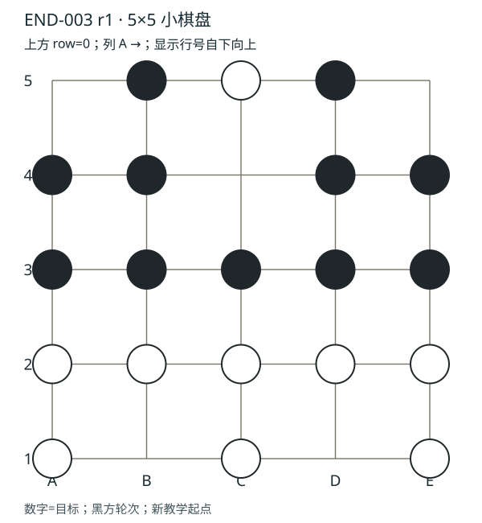

请按本例状态与假设判断，再逐项核对。

完整坐标：黑：B5 D5 A4 B4 D4 E4 A3 B3 C3 D3 E3；白：A2 B2 C2 D2 E2 A1 C1 E1 C5

条件：真实完整 5×5 小棋盘练习；新教学起点，过去劫史未知。 教学假设双方已同意 C5 白子为死子，移除其完整一子块。此处不伪造真实双方确认。 可实际演示黑 C4 提掉 C5；该演示是新教学起点的合法变化。 这是给定存活与死子约定的教学算例，不是某场已确认实战记录。 除明确标记死子外，盘上棋子按活子计算。提子数不额外计入面积。

成功标准：逐项计算并说明结论依据。

### 答案与解释

黑活子 11 + 黑围空 4 = 15。白活子 8 + 白围空 2 + 贴目 0 = 10。中立 0 点不归双方。盘面核对：活子与三类空点合计 25。 C5 移除后是黑方围空之一，不作为提子另加分。
围空明细：黑 A5 C5 E5 C4；白 B1 D1；中立 无。

### 三层提示

1. 先读本例终局状态与假设。
2. 按整块核对死子与空区的完整边界。
3. 最后才代入面积公式；未完反例保留空答案。

常见错误：漏算活子、把提子账本再次相加，或把中立区分给一方。

同伴讨论：一人逐点标空区，另一人核对活子，最后检查总和是否覆盖全盘。

补充合法变化：
- 黑C4：提掉 C5 白子。

验证：结构、合法起点、已记载变化、适用答案目标与外部概念参考分别记录于 validation/results.json 的同 ID 条目。humanReviewed=null。未覆盖的合法手为 unknown。

## END-004  r1　贴目变化：同一面积不同结果

完整 5×5 小棋盘练习　黑方轮次　明确教学假设

请按本例状态与假设判断，再逐项核对。

完整坐标：黑：A5 C5 E5 A4 B4 C4 D4 E4；白：A2 B2 C2 D2 E2 A1 C1 E1

条件：真实完整 5×5 小棋盘练习；新教学起点，过去劫史未知。 主算例开局贴目为 0.5。另开教学情境比较 0 与 2.5，不在已开始的同一局中途改贴目。 中间整行按教学约定保留中立；0、0.5、2.5 都只是教学参数，不是官方小棋盘标准。 这是给定存活与死子约定的教学算例，不是某场已确认实战记录。 除明确标记死子外，盘上棋子按活子计算。提子数不额外计入面积。

成功标准：逐项计算并说明结论依据。

### 答案与解释

黑活子 8 + 黑围空 2 = 10。白活子 8 + 白围空 2 + 贴目 0.5 = 10.5。中立 5 点不归双方。盘面核对：活子与三类空点合计 25。
围空明细：黑 B5 D5；白 B1 D1；中立 A3 B3 C3 D3 E3。
另开情境比较：贴目 0，黑 10，白 10；贴目 0.5，黑 10，白 10.5；贴目 2.5，黑 10，白 12.5。

### 三层提示

1. 先读本例终局状态与假设。
2. 按整块核对死子与空区的完整边界。
3. 最后才代入面积公式；未完反例保留空答案。

常见错误：漏算活子、把提子账本再次相加，或把中立区分给一方。

同伴讨论：一人逐点标空区，另一人核对活子，最后检查总和是否覆盖全盘。

验证：结构、合法起点、已记载变化、适用答案目标与外部概念参考分别记录于 validation/results.json 的同 ID 条目。humanReviewed=null。未覆盖的合法手为 unknown。

## END-005  r1　提子更多也不额外加分

完整 5×5 小棋盘练习　黑方轮次　明确教学假设

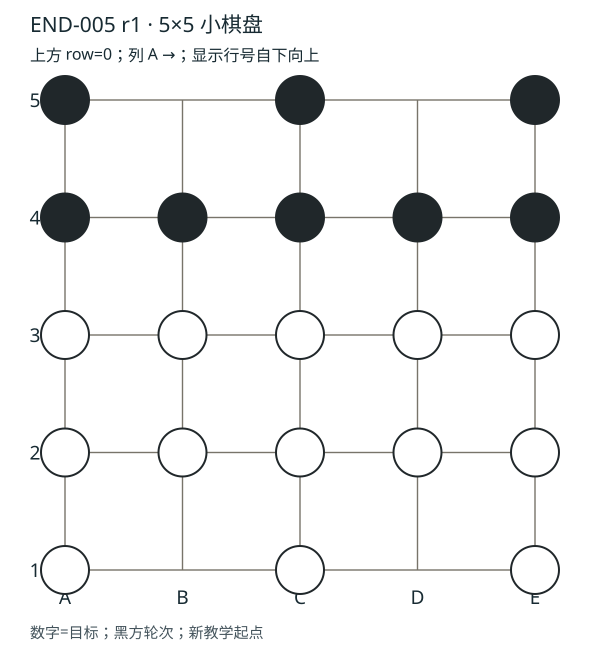

请按本例状态与假设判断，再逐项核对。

完整坐标：黑：A5 C5 E5 A4 B4 C4 D4 E4；白：A3 B3 C3 D3 E3 A2 B2 C2 D2 E2 A1 C1 E1

条件：真实完整 5×5 小棋盘练习；新教学起点，过去劫史未知。 B=12、W=1 只是反事实比较用的提子账本标签，不是重建或声称存在这样的历史棋谱。把标签换成 B=0、W=0，面积计算仍相同。 这是给定存活与死子约定的教学算例，不是某场已确认实战记录。 除明确标记死子外，盘上棋子按活子计算。提子数不额外计入面积。

成功标准：逐项计算并说明结论依据。

### 答案与解释

黑活子 8 + 黑围空 2 = 10。白活子 13 + 白围空 2 + 贴目 0 = 15。中立 0 点不归双方。盘面核对：活子与三类空点合计 25。 提子账本 B=12、W=1 不参与公式，白仍多 5 分。
围空明细：黑 B5 D5；白 B1 D1；中立 无。

### 三层提示

1. 先读本例终局状态与假设。
2. 按整块核对死子与空区的完整边界。
3. 最后才代入面积公式；未完反例保留空答案。

常见错误：漏算活子、把提子账本再次相加，或把中立区分给一方。

同伴讨论：一人逐点标空区，另一人核对活子，最后检查总和是否覆盖全盘。

验证：结构、合法起点、已记载变化、适用答案目标与外部概念参考分别记录于 validation/results.json 的同 ID 条目。humanReviewed=null。未覆盖的合法手为 unknown。

## END-006  r1　反例：未完与争议不能报终局分

完整 5×5 小棋盘练习　黑方轮次　未完／争议反例

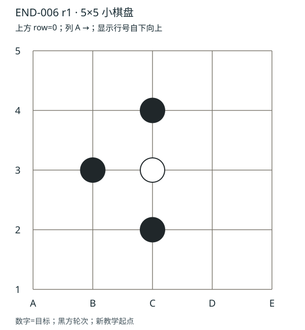

请按本例状态与假设判断，再逐项核对。

完整坐标：黑：C4 B3 C2；白：C3

条件：真实完整 5×5 小棋盘练习；新教学起点，过去劫史未知。 目前只有摆棋局面，没有两次停手和死子共识。C3 白子仍有 D3 一气，不能自动从原盘删除。 继续对弈时黑 D3 可实际提掉 C3。若在两停确认阶段出现争议，应恢复对弈并保留原盘与重复历史。 本例不提供最终得分或胜者。

成功标准：拒绝最终分数，提出继续下或核对争议。

### 答案与解释

正确结论是继续下或先解决争议，不能报最终分数。黑 D3 是合法提子示范；两停只进入确认，有争议时恢复对弈，不能自动判死。

### 三层提示

1. 先读本例终局状态与假设。
2. 按整块核对死子与空区的完整边界。
3. 最后才代入面积公式；未完反例保留空答案。

常见错误：将未完棋盘的空区染色当作最终胜负，或未同意就删掉有气白子。

同伴讨论：如果同伴不接受死子判断，怎样用实际着法演示？

补充合法变化：
- 黑D3：提掉 C3 白子；仍不自动宣布全盘结束。

验证：结构、合法起点、已记载变化、适用答案目标与外部概念参考分别记录于 validation/results.json 的同 ID 条目。humanReviewed=null。未覆盖的合法手为 unknown。
